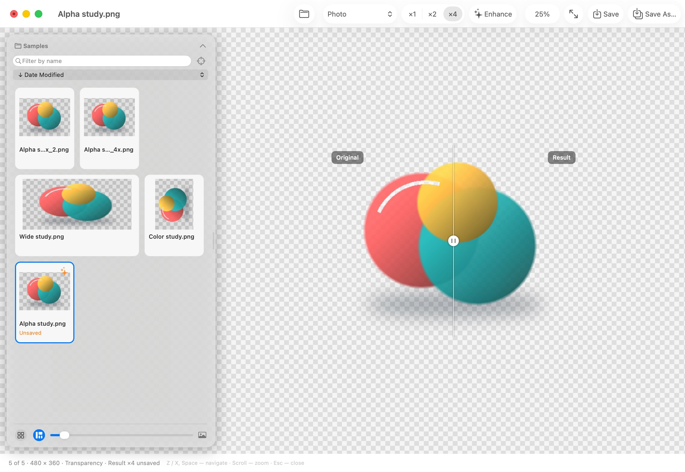

# NCF Image Upscaler

**Offline AI image enhancement for Mac, with a native interface and a command-line tool.**

Enhance photos and illustrations on Apple Silicon using [MLX](https://github.com/ml-explore/mlx)
and [Real-ESRGAN](https://github.com/xinntao/Real-ESRGAN). Keep transparent edges,
soft shadows, and partial alpha intact. Your images stay on your Mac.



*Native interface with a synthetic transparency sample, enhanced locally at ×4.*

- **Local processing.** No accounts, subscriptions, activation, telemetry, or hosted inference.
- **Native macOS app.** Browse folders, compare the original and result with a draggable divider,
  zoom, and save individual enhancements.
- **×1, ×2, and ×4.** Enhance at the original size or increase resolution, with photo,
  illustration, and lightweight model presets.
- **Transparency support.** Preserve RGBA and partial alpha without adding a background.
- **Safe outputs.** Processing never replaces the original. Results are saved as separate PNGs.
- **Scriptable.** Use the same processing engine through the `ncf-upscale` command.

## Download for Mac

**[Download NCF Image Upscaler 0.4.0 for Apple Silicon](https://github.com/no-colours-fabric/ncf-image-upscaler/releases/download/v0.4.0/NCFImageUpscaler-0.4.0-arm64.dmg)** · [All releases and checksums](https://github.com/no-colours-fabric/ncf-image-upscaler/releases)

Requires **macOS 14 or later** and **Apple Silicon** (M1 or later).
No separate Python or Xcode installation is needed. There are no accounts,
subscriptions, or activation.

1. Open the DMG and drag **NCF Image Upscaler** into **Applications**.
2. Open the app. It installs its bundled engine locally on the first launch.
3. Choose **Download Models** in the setup window. All presets total about 78 MB;
   this is an explicit download. After setup, processing works offline.
4. Open an image or folder, select a model and scale, click **Enhance**, then **Save**.

**Not notarized by Apple.** This build uses a local ad-hoc signature rather than
an Apple Developer ID signature. If macOS blocks the first launch and you trust
the downloaded release, use **System Settings → Privacy & Security → Open Anyway**,
then confirm **Open**. See [Apple's instructions](https://support.apple.com/en-us/102445).
The release includes a SHA-256 checksum. Do not override a malware or damaged-app warning.

Open **NCF Image Upscaler → Models…** to check models, finish downloading them, or retry
an interrupted download. The app never downloads models when you start inference.
Intel Macs, Windows, and Linux are not supported. See [limitations](#limitations).

## Documentation

| Guide | What it covers |
| --- | --- |
| [Installation and storage](docs/installation.md) | Verify a download, install or update, find local files, troubleshoot, and uninstall |
| [User guide](docs/usage.md) | First launch, models, image comparison, saving, keyboard shortcuts, and CLI options |
| [Contributing](CONTRIBUTING.md) | Architecture, development setup, and checks |
| [Binary release guide](docs/binary-release.md) | Build and verify a standalone macOS DMG |
| [Verification notes](docs/verification.md) | Recorded checks and their limits |
| [Changelog](CHANGELOG.md) | Changes by version |

For a reproducible problem, [open a bug report](https://github.com/no-colours-fabric/ncf-image-upscaler/issues/new?template=bug_report.yml).
Include the app version, Mac chip, macOS version, installation method, and steps to reproduce.
Share images only if they are safe to make public. For security vulnerabilities,
follow [SECURITY.md](SECURITY.md).

## Install from source

Source installation requires **Python 3.12–3.14** and **Xcode Command Line Tools**
(for the native app). Install the latter with `xcode-select --install`.

```sh
git clone https://github.com/no-colours-fabric/ncf-image-upscaler.git
cd ncf-image-upscaler
./scripts/install.sh
```

Alternatively, use **Code → Download ZIP**, extract the archive, and run the installer
from its folder. The installer creates `~/Applications/NCF Image Upscaler.app` and the
`ncf-upscale` command. It does not download Python or model weights. If it adds
`~/.local/bin` to your shell profile, open a new terminal before using the command.

Download models from the app's **Models…** window or explicitly from the CLI:

```sh
ncf-upscale models download all
ncf-upscale doctor
```

Use `./scripts/install.sh --cli-only` for the command-line tool alone. The DMG does
not modify your shell profile or install a command into `PATH`.
Select a source-build interpreter with
`NCF_IMAGE_UPSCALER_PYTHON=/path/to/python3.12 ./scripts/install.sh`.

Normal source installation copies the package into Application Support; the source
folder can then be moved or deleted. Keep the selected Python installation available.
The DMG contains a separate standalone engine and does not depend on a source installation.

## Command-line usage

```sh
ncf-upscale photo.jpg
ncf-upscale photo.jpg --scale 1
ncf-upscale photo.jpg --scale 2
ncf-upscale transparent.png --model anime
ncf-upscale photo.jpg --model fast --output result.png
```

The default is the photo preset at ×4. `photo.jpg` becomes `photo_4x.png` beside the
original. Existing CLI outputs require `--overwrite`; even that flag cannot replace
the original. Use `--quiet` to print only the output path to stdout.

```sh
ncf-upscale --help
ncf-upscale models list
ncf-upscale models verify
```

See the [user guide](docs/usage.md) for models, keyboard shortcuts, file operations,
transparency handling, and troubleshooting.

## Privacy and storage

Inference runs on the local Apple GPU. The native app starts a local Python worker;
it does not run a web server. Processing never downloads a missing model automatically.
Downloads use public model URLs without tokens, pinned to revisions and verified by SHA-256.

The first-launch engine installation uses only the bundled payload, with integrity checks
and no network access. Model downloads use a bundled CA certificate store for HTTPS.

Models, dependencies, runtime environments, and installation caches live under
`~/Library/Application Support/ncf-image-upscaler/`, outside the repository.
Private temporary sessions hold unsaved enhancements and thumbnail caches.
See [storage and installation](docs/installation.md) for details and removal instructions.

## Limitations

- The processing pipeline uses **8-bit RGB/RGBA**. HDR, high-bit-depth workflows,
  animations, and multipage images are not supported.
- Alpha is resized with Lanczos, independently of the model. At ×1 it is copied
  unchanged. The model enhances color; it does not reconstruct the alpha mask.
- EXIF orientation is applied and the embedded ICC profile is retained. Other EXIF
  metadata is not copied. Outputs are PNG.
- Tiling limits GPU memory per pass; large output images still require RAM.
- AI enhancement can change textures, lettering, and fine details. Inspect the result
  before using it where fidelity matters.

## Development

```sh
./scripts/install.sh --dev
"$HOME/Library/Application Support/ncf-image-upscaler/runtime/env/bin/python" -m pytest -m 'not integration'
"$HOME/Library/Application Support/ncf-image-upscaler/runtime/env/bin/ruff" check .
"$HOME/Library/Application Support/ncf-image-upscaler/runtime/env/bin/ruff" format --check .
./scripts/test-native.sh
```

Development mode is editable and requires the source folder to stay in place.
GPU integration tests use locally installed models and never download weights.
See [CONTRIBUTING.md](CONTRIBUTING.md) for architecture and testing,
[verification notes](docs/verification.md) for local results, and
[CHANGELOG.md](CHANGELOG.md) for release notes.

## License and acknowledgments

NCF Image Upscaler is licensed under [BSD-3-Clause](LICENSE). It uses existing
Real-ESRGAN models and an MLX port; it does not claim to train a new model.
Third-party components retain their own licenses, including Apache-2.0 for
BasicSR-derived code. See [THIRD_PARTY.md](THIRD_PARTY.md) and [licenses/](licenses/).

Bug reports and focused contributions are welcome. Read [CONTRIBUTING.md](CONTRIBUTING.md)
and use [SECURITY.md](SECURITY.md) for vulnerability reports.
